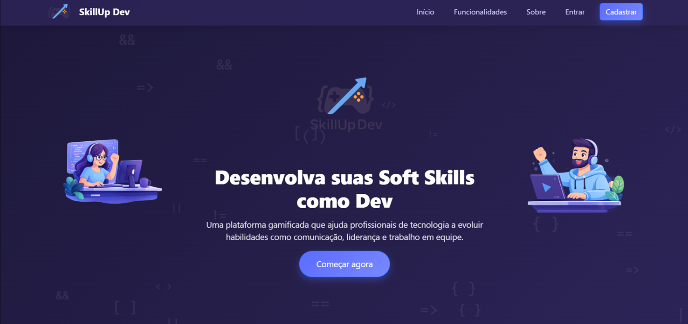
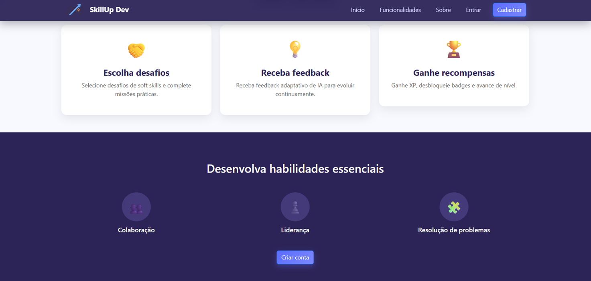
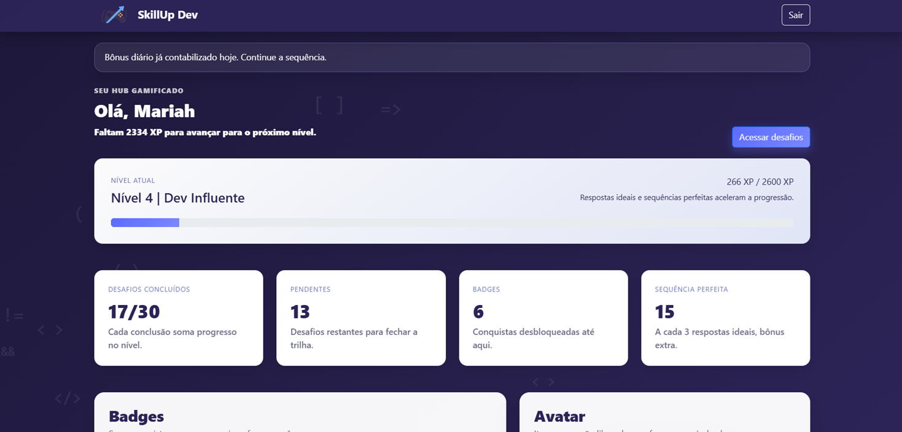
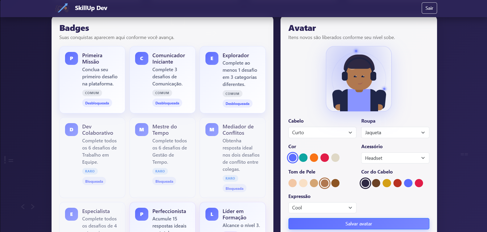
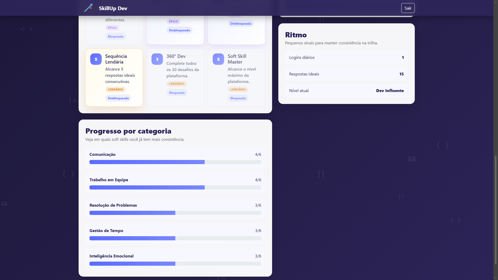
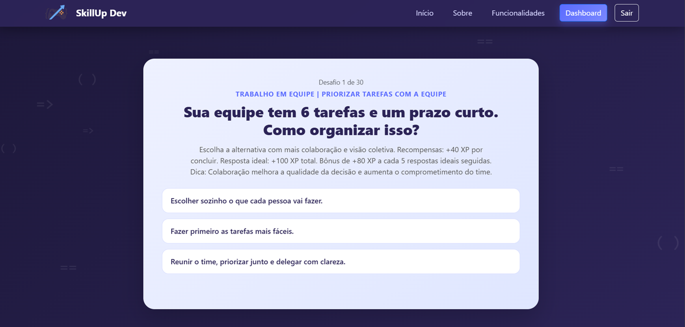
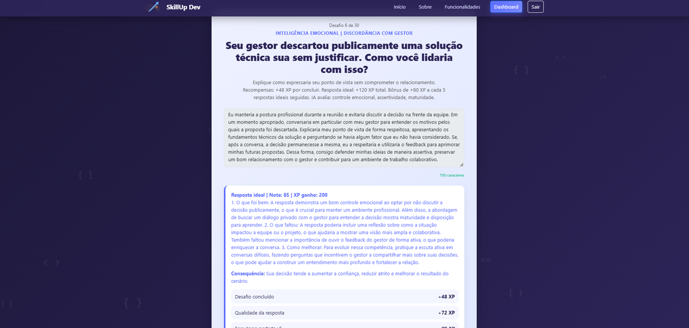
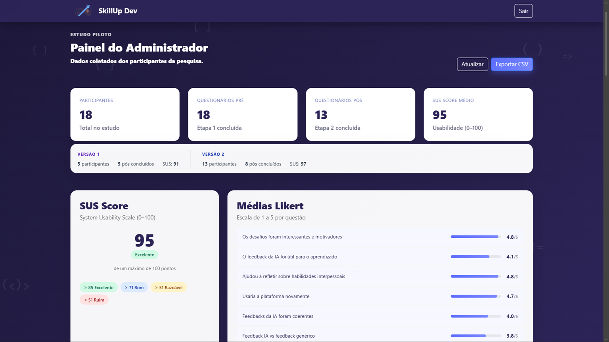

# 🚀 SkillUp Dev

Plataforma web gamificada voltada ao apromoramento de soft skills para desenvolvedores, com desafios interativos e feedback automatizado com apoio de IA.

      -4169E1?style=for-the-badge&logo=postgresql&logoColor=white) 

## 📌 Sobre o projeto

O **SkillUp Dev** foi idealizado como um projeto acadêmico (TCC) no Centro Universitário de João Pessoa (UNIPÊ), com o objetivo de ajudar desenvolvedores a aprimorarem habilidades interpessoais essenciais para o mercado de trabalho.

A proposta da plataforma é proporcionar um ambiente interativo onde o usuário pode enfrentar situações do cotidiano profissional e receber feedbacks construtivos, promovendo aprendizado contínuo.

💡 O TCC foi apresentado e aprovado, e o projeto segue em evolução depois da graduação. Veja a [linha do tempo](#️-linha-do-tempo) e o [roadmap pós-TCC](#-roadmap-pós-tcc).

## 🎯 Objetivo

Desenvolver uma solução digital que auxilie desenvolvedores a aprimorarem soft skills como:

* Comunicação
* Trabalho em equipe
* Resolução de problemas
* Pensamento crítico

## 💻 Tecnologias utilizadas

| Camada | Tecnologia |
|--------|------------|
| 🎨 Front-end | HTML5 • CSS3 • JavaScript |
| ⚙️ Back-end | Node.js • Express |
| 🤖 IA | OpenAI API (GPT-4o mini) |
| 🗄️ Banco de Dados | PostgreSQL no Neon (produção) • PGlite (desenvolvimento e testes) |
| ☁️ Hospedagem | Render |
| 📧 E-mail | Resend |
| 🔒 Segurança | Helmet • Express Rate Limit • CORS |

## 🚀 Funcionalidades

* 🎮 Desafios interativos simulando situações reais
* 🤖 Feedback automatizado com apoio de inteligência artificial
* 📊 Interface focada na experiência do usuário (UI/UX)
* 🌐 Navegação intuitiva e responsiva

## 📷 Preview

### 🏠 Tela inicial

### 📊 Dashboard

### 🎮 Desafios Multipla Esccolha

### 🎮 Desafios Dissertativos + 🤖 Feedback da IA

### 🖥️ Painel do Admin

## 📚 Validação Empírica - Estudo Piloto

| Dimensão avaliada | V1 | V2 | Variação |
| :--- | :---: | :---: | :---: |
| SUS Score Médio | 91,2 | 97,9 | **+6,7** |
| Desafios interessantes e motivadores | 4,4/5 | 5,0/5 | **+0,6** |
| Utilidade do feedback da IA | 2,8/5 | 5,0/5 | **+2,2** |
| Reflexão sobre soft skills | 4,6/5 | 5,0/5 | **+0,4** |
| Intenção de uso futuro | 4,2/5 | 5,0/5 | **+0,8** |
| Coerência percebida do feedback | 2,6/5 | 5,0/5 | **+2,4** |
| Diferenciação entre respostas genéricas | 2,6/5 | 4,9/5 | **+2,3** |

## 🔗 Acesso ao projeto

## 📈 Status do projeto

✅ TCC apresentado e aprovado · 🔧 Publicado e em evolução contínua após a graduação

## 🗓️ Linha do tempo

### 🎓 Durante o TCC (mar–jun/2026)

* **Mar/2026:** início do projeto e estrutura do front-end.
* **Abr/2026:** back-end em Node.js/Express, primeiros desafios, gamificação (XP, níveis, badges) e avatar.
* **Mai/2026:** recuperação de senha com envio de e-mail.
* **Jun/2026:** rebalanceamento de XP, níveis e badges; reescrita dos desafios abertos com cenários únicos; estudo piloto (V1 e V2) com painel administrativo; publicação da plataforma.

### 🔧 Depois do TCC

* **Jul/2026:** persistência migrada de arquivo JSON para Upstash Redis; deploy movido para o Render.
* **Out/2026:** auditoria técnica completa (arquitetura, segurança, performance, testes e produto), que deu origem ao roadmap abaixo.

## 🧭 Roadmap pós-TCC

A auditoria concluiu que o núcleo do produto — cenário realista + resposta aberta + feedback da IA — está validado e deve ser preservado. O que precisa evoluir é a base técnica, feita para um estudo piloto: a camada de dados, a organização do código e o modelo de "responder cada desafio uma única vez".

A ordem das fases segue a prioridade: primeiro estabilizar, depois criar a base para crescer e só então expandir o produto.

### Fase 0 — Estabilização `P0`

Correções pequenas e pontuais antes de qualquer funcionalidade nova.

- [ ] Rotacionar credenciais de serviços externos
- [x] Script de backup do banco (`npm run backup`)
- [x] Impedir que uma falha de leitura do banco sobrescreva os dados existentes
- [x] Impedir pontuação duplicada em envios simultâneos do mesmo desafio
- [x] Endurecer o fluxo de recuperação de senha (link de teste só em desenvolvimento, URL fixa por configuração, resposta sem revelar contas cadastradas)
- [x] Timeouts nas chamadas à OpenAI e ao Resend
- [x] Política de segurança de conteúdo (CSP) mais restrita e escape do feedback exibido na tela
- [ ] Revisar dados antigos presentes no histórico do repositório

### Fase 1 — Fundação `P1`

Base técnica para o projeto crescer com segurança.

- [x] Testes automatizados das regras atuais (XP, níveis, badges, sequências) antes de refatorar (`npm test`)
- [x] Testes de integração da API (cadastro, login, reset de senha, envio de desafios, admin)
- [x] Dividir o `server.js` em módulos (auth, desafios, avaliação, gamificação, estudo)
- [x] Migrar o banco para PostgreSQL (Neon) com migrações e importação dos dados atuais
- [ ] Validação das variáveis de ambiente na inicialização
- [ ] Sessão em cookie seguro e limites de requisição por rota e por conta
- [ ] Papéis de usuário no lugar do `isAdmin`
- [x] Avaliação da IA mais robusta: saída estruturada, proteção contra manipulação da nota e registro de quem avaliou (IA ou heurística)
- [x] Lint, formatação e CI (ESLint, Prettier e GitHub Actions)

### Fase 2 — Experiência `P1/P2`

Fazer a plataforma parecer um produto, não um projeto acadêmico.

- [ ] Tirar o fluxo do estudo piloto da jornada principal (vira configuração)
- [ ] Histórico de feedbacks e dashboard focado na evolução
- [ ] Design system com tokens e ícones SVG
- [ ] Acessibilidade (teclado, leitores de tela, formulários)
- [ ] Imagens otimizadas e suporte a `prefers-reduced-motion`
- [ ] Página de conta: perfil, troca de senha, exclusão e exportação dos dados
- [ ] Política de privacidade, termos de uso e aviso sobre o uso de IA (LGPD)
- [ ] Ajustes de regras e textos (dica do desafio, login diário, textos alinhados ao código)

### Fase 3 — Soft skills `P2`

Passar de "responder uma vez" para "praticar e evoluir".

- [ ] Taxonomia de competências ligada aos critérios de avaliação
- [ ] Várias tentativas por desafio e nota por critério
- [ ] Trilhas por competência com dificuldade progressiva
- [ ] Diário de reflexão após o feedback
- [ ] Conteúdo gerenciado pelo painel admin, sem precisar de deploy
- [ ] Badges por regras configuráveis

### Fase 4 — IA `P2`

IA como coach auditável.

- [ ] Conjunto fixo de respostas para avaliar o avaliador a cada mudança de prompt ou modelo
- [ ] Feedback que considera tentativas anteriores
- [ ] Recomendação da próxima trilha e resumo de evolução
- [ ] Geração de cenários com revisão humana
- [ ] Monitoramento de custo e latência; remoção de dados pessoais antes do envio

### Fase 5 — Empresas `P2/P3`

- [ ] Organizações, times e convites
- [ ] Papéis: colaborador, gestor, admin da organização e admin da plataforma
- [ ] Dashboards agregados e anonimizados para gestores
- [ ] Trilhas por empresa, relatórios e log de auditoria

### Fase 6 — Operação `P3`

- [ ] Hospedagem sem hibernação, ambiente de staging e backups testados
- [ ] Logs estruturados, monitoramento de erros e alertas
- [ ] Login com Google/Microsoft
- [ ] Planos e cobrança

## 🎓 Instituição

Centro Universitário de João Pessoa (UNIPÊ)
Trabalho de Conclusão de Curso – Ciência da Computação
2026
